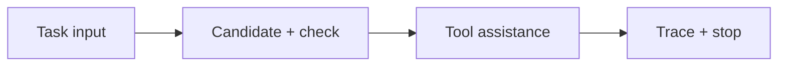
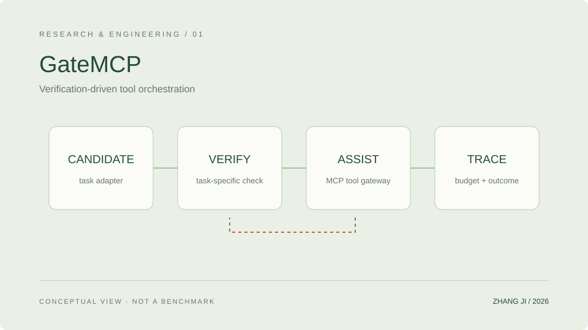

<!-- Generated from data/. Review release permissions before copying to another repository. -->
# GateMCP · Verification-driven Tool Orchestration

An inspectable agent workflow for deciding when to use a tool and when to stop, separating task verification, staged assistance, and budget control.

围绕“何时调用工具、何时停止”构建可检查的 Agent 工作流，将任务验证、分阶段辅助与预算控制分开实现。

**Status:** Research · In Progress · Content reviewed 2026-10-11

## Problem

Tool use does not automatically make an answer reliable. This project studies how task-specific checks can guide additional assistance while making call costs and stopping decisions explicit.

工具调用并不天然意味着答案可靠。研究关注在可验证任务中，如何让候选答案先经过任务检查，再决定是否需要进一步辅助，同时记录每次调用的成本与终止原因。

## Features and implementation scope

- Separates the controller, task adapters, tool gateway, and metrics so policy and tool implementations can be inspected independently.
- Provides a local task gateway and a FastMCP stdio interface around shared task-verification logic.
- Includes protocol configuration, run entry points, method mappings, tests, and result aggregation tools.

These are verified project capabilities, not a claim of sole authorship. Individual contributions and collaborators still need to be confirmed.

## Architecture

A high-level view of controller, gateway, and adapter responsibilities. Policies may verify again or request further assistance; this is not a general open-world agent.

This original SVG is a schematic, not a runtime screenshot. Keep the linked asset when reusing this draft.

## Implementation

- Python controller entry points connect model decisions to task tools through a gateway.
- Task adapters cover math word problems, Game24, and block-world planning. Verification is bounded by each task definition.
- The code snapshot separates protocols, model-path examples, data requirements, and outputs. Frozen datasets are excluded from the GitHub-targeted bundle.

**Stack:** Python · MCP · FastMCP · Verification · Tool Calling

## Installation and quick start

This is a documentation draft, not a standalone code release. Do not claim that cloning this website installs the research project. A verified source version, license, authorized data, and environment-specific instructions must be supplied before a reproducible quick start can be published.

## Configuration and data

Use non-sensitive example configuration only. Do not add credentials, private machine paths, datasets, or checkpoints to a release. Code licensing does not grant rights to redistribute datasets or model weights.

## Evidence and limitations

- Controller, MCP server, task gateway, and standard-library test files have been inspected.
- This page presents engineering structure and the research question, without promoting simulated traces or narrow comparisons to general performance claims.

- A public source release has not been verified; the project bundle does not specify a license.
- Manuscripts, raw experiment records, models, and data are not published here. A research draft is not labelled accepted or published.

No benchmark values are fabricated. This documentation refresh does not rerun research experiments.

## Demo and source

No public demo is linked yet. Architecture illustrations must not be labelled as runtime screenshots.

A verified public source release has not been linked. This file does not grant access to private code.

## Next steps

- Confirm ownership and licensing, then prepare a reproducible example without private configuration.
- Add real execution screenshots, full protocols, and verifiable result links once the release scope is approved.

## Citation and license

Do not invent a citation or publication status. Add a verified public citation only after title, authors, venue, year, and status are confirmed. Preserve upstream licenses; this draft does not assign a license to another project.
