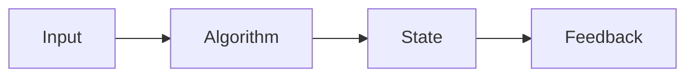
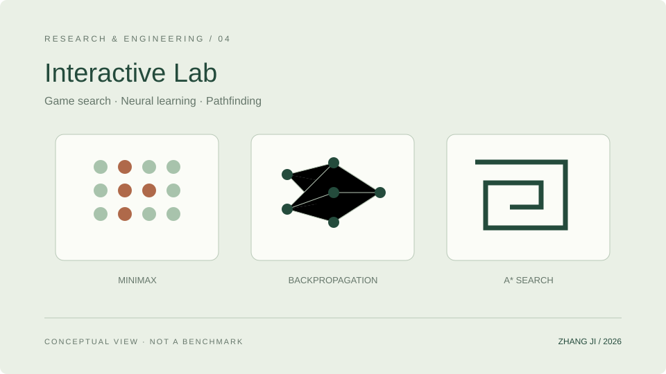

<!-- Generated from data/. Review release permissions before copying to another repository. -->
# Interactive Algorithm Lab

Hands-on browser experiments in search, learning, and planning: AI Connect Four, a tiny neural network, and shareable A* mazes.

把搜索、学习与路径规划做成可操作的浏览器实验：AI 四子棋、微型神经网络和可分享的 A* 迷宫。

**Status:** Implemented · Evolving · Content reviewed 2026-10-11

## Problem

Algorithm inputs, decisions, and outcomes are often hidden in code. This lab makes them interactive, observable, and resettable so readers can learn by changing the input.

算法的输入、决策和结果往往藏在代码里。这个实验室把关键过程变成可以操作、观察和复位的交互，让读者通过改变输入来理解算法。

## Features and implementation scope

- Connect Four uses Minimax and alpha–beta pruning in a background Worker, with undo and local two-player modes.
- The neural canvas implements a real 2→8→1 network with backpropagation, displaying training loss and decision boundaries.
- Seeded deterministic mazes support manual exploration, A* paths, and sharing the same challenge.

These are actual modules in the site. AI-assisted development and algorithm implementations are not claims of inventing those algorithms.

## Architecture



Only Connect Four search uses a Worker. Neural and maze algorithms run in the browser. There are no external LLM calls or live multiplayer rooms.



This original SVG is a schematic, not a runtime screenshot. Keep the linked asset when reusing this draft.

## Implementation

- lib/lab separates algorithms from the UI for deterministic unit checks.
- Sharing carries validated board codes or seeds rather than uploading personal data.
- Bilingual interfaces and keyboard / touch controls use the site’s existing themes and routing.

**Stack:** TypeScript · Vue · Web Workers · Minimax · A*

### The network’s forward pass

```typescript
const sigmoid = (x: number) => 1 / (1 + Math.exp(-Math.max(-40, Math.min(40, x))))
export function predict(network: Network, x: number, y: number): number {
  let sum = network.outputBias
  for (let i = 0; i < 8; i++) sum += Math.tanh(network.hidden[i]![0]! * x + network.hidden[i]![1]! * y + network.bias[i]!) * network.output[i]!
  return sigmoid(sum)
}
```

An excerpt of the lab’s existing sigmoid and predict functions, using the project’s Network type. This is forward-pass source, not a standalone script or a training result.

### The same computation, in equations

```math
\begin{aligned}
h_i &= \tanh(w_{i1}x + w_{i2}y + b_i), \quad i = 1,\ldots,8 \\
z &= c + \sum_{i=1}^{8} v_i h_i \\
p &= \frac{1}{1 + \exp(-\operatorname{clip}(z,-40,40))}
\end{aligned}
```

Inputs x and y pass through eight tanh hidden units. Their weighted sum includes output bias c; the source clips it to −40…40 before applying sigmoid to obtain probability p.

These equations describe the implementation. Unit counts and clipping bounds are code constants, not experimental metrics.

## Installation and quick start

This module is part of the Nuxt site. In an authorized development environment with Node.js ≥ 22.13 and the locked dependencies available:

```sh
npm run test:lab
npm run generate
node scripts/serve-static.mjs --host 127.0.0.1 --port 4178
```

Open /lab or /en/lab. Do not start a local service when server-first execution is required.

## Configuration and data

Use non-sensitive example configuration only. Do not add credentials, private machine paths, datasets, or checkpoints to a release. Code licensing does not grant rights to redistribute datasets or model weights.

## Evidence and limitations

- All three interactions have algorithm source, UI components, and in-site demos.
- Algorithm tests cover board validation, search, neural training, and path correctness. This update’s execution status is recorded in the validation report.

- Neural accuracy describes the demo training set, not independent test or research performance.
- Sharing is not live multiplayer. There are no accounts, leaderboards, messaging backends, or server-side agents.

No benchmark values are fabricated. This documentation refresh does not rerun research experiments.


## Demo and source

The site includes an interactive demo at /lab. A confirmed public site URL is needed before an external link can be generated.


A verified public source release has not been linked. This file does not grant access to private code.

## Next steps

- Expand checks on physical touchscreens and assistive technology.
- Keep algorithm modules independent, with deterministic tests and explanations for new experiments.

## Citation and license

Do not invent a citation or publication status. Add a verified public citation only after title, authors, venue, year, and status are confirmed. Preserve upstream licenses; this draft does not assign a license to another project.
