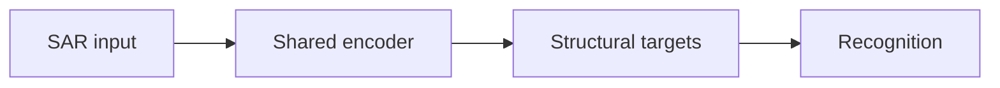
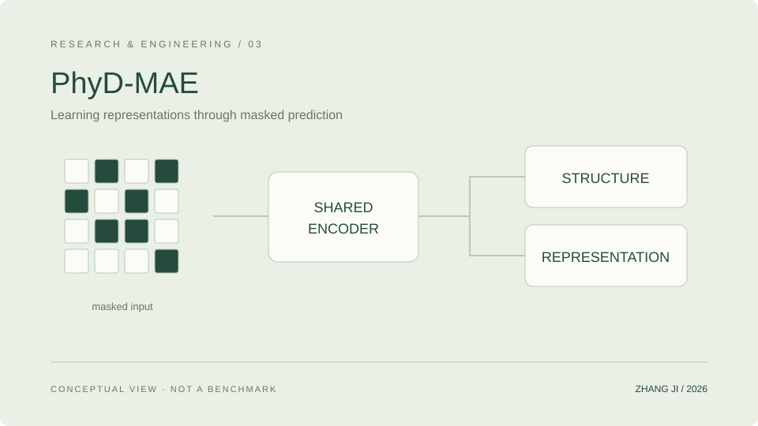

<!-- Generated from data/. Review release permissions before copying to another repository. -->
# PhyD-MAE · Self-supervised SAR Representations

Masked-prediction research for SAR target recognition, exploring structured supervision targets and a shared visual encoder.

面向 SAR 目标识别的掩码预测研究，探索结构化监督目标与共享视觉编码器之间的关系。

**Status:** Research · In Progress · Content reviewed 2026-10-11

## Problem

SAR annotations are limited, and pixel reconstruction need not align with recognition. This work studies supervision targets that connect masked prediction to downstream representation learning.

SAR 标注有限，而像素重建目标不一定与识别所需的表征一致。研究关注如何设计自监督目标，让掩码预测服务于下游表征学习。

## Features and implementation scope

- Implements masked pretraining with a shared encoder and deterministic structural targets.
- Maintains pretraining entry points, environment documentation, and downstream recognition code.
- Separates pretraining objectives, representation evaluation, and paper evidence.

Only verifiable project structure is summarized. Author order, affiliations, collaborations, and sole authorship are not inferred.

## Architecture

A conceptual view from pretraining to downstream evaluation. This is representation-learning research, not a denoising product.

This original SVG is a schematic, not a runtime screenshot. Keep the linked asset when reusing this draft.

## Implementation

- Models and training are implemented in Python / PyTorch, with structural-target modules and explicit image-input constraints.
- Environment documentation separates dependencies, data preparation, and smoke examples; example images do not replace research datasets.

**Stack:** Python · PyTorch · Masked Modeling · Self-supervised Learning · SAR

## Installation and quick start

This is a documentation draft, not a standalone code release. Do not claim that cloning this website installs the research project. A verified source version, license, authorized data, and environment-specific instructions must be supplied before a reproducible quick start can be published.

## Configuration and data

Use non-sensitive example configuration only. Do not add credentials, private machine paths, datasets, or checkpoints to a release. Code licensing does not grant rights to redistribute datasets or model weights.

## Evidence and limitations

- Pretraining source, structural-target classes, and run documentation support this project overview.
- This website update does not retrain models, run inference, or recompute paper results.

- A manuscript or submission record is not evidence of acceptance or publication. A paper entry awaits verification of public metadata.
- Raw SAR data, frozen manuscripts, model weights, and internal experiment tables are not distributed here.

No benchmark values are fabricated. This documentation refresh does not rerun research experiments.

## Demo and source

No public demo is linked yet. Architecture illustrations must not be labelled as runtime screenshots.

A verified public source release has not been linked. This file does not grant access to private code.

## Next steps

- Verify a public source version and third-party licenses before adding a reproducible minimal example.
- Synchronize the publications page after authorship, paper status, and public links are confirmed.

## Citation and license

Do not invent a citation or publication status. Add a verified public citation only after title, authors, venue, year, and status are confirmed. Preserve upstream licenses; this draft does not assign a license to another project.
