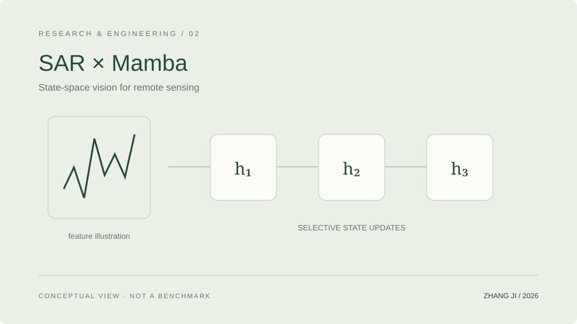

<!-- Generated from data/. Review release permissions before copying to another repository. -->
# SAR × Mamba · State-space Vision

Exploring how SAR imaging characteristics meet state-space vision models through feature processing, state updates, and controlled detection studies.

研究 SAR 成像特点与状态空间视觉模型的衔接，围绕特征处理、状态更新和目标检测开展实现与受控比较。

**Status:** Research · In Progress · Content reviewed 2026-10-11

## Problem

Speckle, clutter, and weak targets make SAR different from natural imagery. This work investigates when state-space modules are useful and whether architectural changes yield reproducible benefits under controlled evaluation.

SAR 的散斑、杂波与弱目标给视觉表征带来不同于自然图像的挑战。研究关注状态空间模块在这种数据上的适用条件，以及结构改动是否能在受控评估中产生可重复的收益。

## Features and implementation scope

- Implements SAR-oriented feature processing and state-space modules in an existing Mamba-YOLO workspace.
- Organizes module configuration, detection training, and evaluation separately, retaining variants and protocols.
- Uses ablations and cross-task checks to study limitations rather than treating model names or diagrams as evidence of effectiveness.

Built on an existing open-source detection framework. Upstream work and individual changes must remain distinct; a contribution statement is pending.

## Architecture

A high-level pipeline, not the exact architecture of an unreleased manuscript. The detection example does not establish how other tasks are implemented.

This original SVG is a schematic, not a runtime screenshot. Keep the linked asset when reusing this draft.

## Implementation

- PyTorch modules and detection configurations live in a source area, with versioned training scripts and result records.
- Comparisons must fix splits, initialization, training budgets, and evaluation protocols; scores from different settings are not combined into a leaderboard.

**Stack:** Python · PyTorch · Mamba · SAR · Object Detection

## Installation and quick start

This is a documentation draft, not a standalone code release. Do not claim that cloning this website installs the research project. A verified source version, license, authorized data, and environment-specific instructions must be supplied before a reproducible quick start can be published.

## Configuration and data

Use non-sensitive example configuration only. Do not add credentials, private machine paths, datasets, or checkpoints to a release. Code licensing does not grant rights to redistribute datasets or model weights.

## Evidence and limitations

- The PyTorch detection structure and state-space research modules have been inspected in the workspace.
- Research is ongoing. Experimental numbers are withheld until their public release scope is confirmed.

- No claim is made of universal cross-dataset improvement, the first use of Mamba for SAR, or state-of-the-art performance.
- The source includes upstream AGPL-3.0 licensing. It is not relabelled MIT, and data or weights are not automatically released.

No benchmark values are fabricated. This documentation refresh does not rerun research experiments.

## Demo and source

No public demo is linked yet. Architecture illustrations must not be labelled as runtime screenshots.

A verified public source release has not been linked. This file does not grant access to private code.

## Next steps

- After checking contributions and licensing, prepare a minimal module example and reproducible environment documentation.
- Public results should include versions, protocols, negative results, limitations, and the corresponding paper status.

## Citation and license

Do not invent a citation or publication status. Add a verified public citation only after title, authors, venue, year, and status are confirmed. Preserve upstream licenses; this draft does not assign a license to another project.
